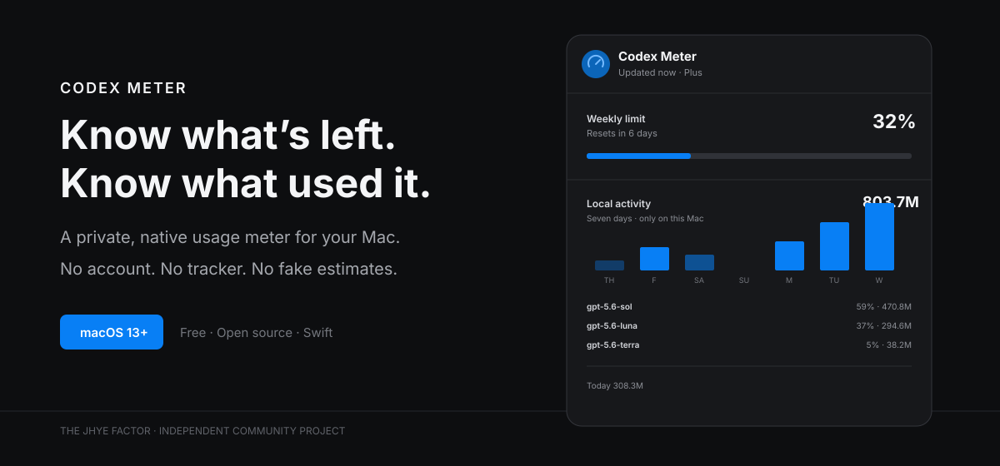

<p align="center">
  
</p>

<h1 align="center">Codex Meter</h1>

<p align="center"><strong>Your Codex limits, reset times, weekly pace and activity in the macOS menu bar.</strong></p>

<p align="center">No extra account. No analytics. No Electron. Just one small native Mac app doing one useful job.</p>

<p align="center">
  <a href="https://github.com/matthewvroom/codex-meter/releases/latest"></a>
  <a href="https://www.swift.org/"></a>
  <a href="LICENSE"></a>
  <a href="https://github.com/matthewvroom/codex-meter/releases/latest"></a>
</p>

Codex Meter is a free, open-source macOS menu bar app that shows how much Codex usage you have left, when it resets, and which models you used on this Mac.

Jhye built Codex Meter to answer one question from the menu bar: **how much Codex do I have left?** This fork adds weekly pace, a compact reset badge, and improvements to quota refresh and local activity.

## At a glance

| Quota | Local insight | Automation |
| --- | --- | --- |
| Remaining percentage | Seven-day This Mac chart | Universal CLI |
| Exact reset time | Model-by-model usage | JSON output |
| Stale and error states | Prompt text stays private | Threshold exit codes |

## Why Codex Meter is different

### Honest when data fails

If Codex cannot return a current limit, Codex Meter says it is unavailable. It never leaves a stale percentage looking current and never invents a reset estimate.

### Open enough to trust

The complete Swift source, local-log parser, build scripts and release automation are public. You can inspect exactly what the app reads and verify that it does not copy credentials or transmit local history.

### A true one-job Mac app

No Electron runtime, background helper daemon, analytics SDK or external database. The native app sleeps between quota checks and scans this Mac's activity only when its panel or menu-bar activity mode needs it.

### Power without a privacy trade-off

Alert thresholds, menu-bar modes, history charts and CLI automation stay on your Mac. No separate API key or external dependency is required.

## Features

- Shows the most constrained Codex allowance directly in the macOS menu bar.
- Shows weekly pace against an even seven-day allowance, with a compact reset, percentage and pace badge.
- Breaks down every available usage window with a percentage and local reset time.
- Refreshes automatically every two minutes, with manual refresh when you want it.
- Warns once when remaining usage crosses below 10%, 20%, or 30%, then waits for recovery or a new reset window.
- Detects stale or unavailable data instead of leaving a misleading old number visible.
- Builds a seven-day This Mac activity chart from aggregate events in Codex session logs on this machine.
- Click a day in the chart to see its token total and usage by hour in local time.
- Marks credit resets at the end of each day in the overview and at the recorded time in the hourly chart.
- Breaks this Mac's recorded usage down by the actual model recorded for each Codex turn.
- Adds profiles through OpenAI's secure browser login and removes local profiles with confirmation under **Settings → Accounts**.
- Shows a quick switcher beside Refresh when two or more profiles are available. Switching changes whose quota Meter displays.
- Shows OpenAI's real banked-reset count when the account returns it, and celebrates reset and token milestones.
- Switches between Icon + Percentage, Reset + Percentage, Reset + Percentage + Pace, Percentage Only, Icon Only and Activity Chart menu-bar modes.
- Includes a universal `codex-meter` CLI with stable text/JSON output and threshold exit codes.
- Supports launch at login without adding a Dock icon.
- Checks both the original project and Matthew's fork for public GitHub releases, with a user-selected update source and manual installation.
- Keeps usage windows, activity, accounts and settings collapsible so the popover stays calm.
- Works natively on Apple silicon and Intel Macs.

## Download and install

1. Download the latest `Codex-Meter-*.zip` from [this fork’s GitHub Releases](https://github.com/matthewvroom/codex-meter/releases/latest).
2. Unzip it and move **Codex Meter.app** into `/Applications`. If you already use Codex Meter, quit it and replace the app in its current location.
3. Open it once. The gauge and remaining percentage will appear in your menu bar.

The ZIP also includes the optional `codex-meter` command-line tool and an installation note.

The community ZIP is ad-hoc signed. If macOS blocks the first launch, see [Apple’s guidance on opening downloaded apps](https://support.apple.com/en-us/102445).

### Requirements

- macOS 13 Ventura or newer
- ChatGPT/Codex installed and signed in
- A Codex plan that returns rate-limit information

Codex Meter checks the ChatGPT app bundle and common Homebrew, npm, Volta, and local CLI locations. Developers launching from Terminal can also set `CODEX_PATH` to an absolute Codex executable path.

Codex Meter keeps each added profile in an isolated `CODEX_HOME`. The desktop Codex app continues to use its existing sign-in. Passwords and verification codes are entered on OpenAI's sign-in page.

## Privacy by design

This app has one job and does not need your data for anything else.

- No analytics
- No ads
- No tracking
- No private update service; optional release checks use GitHub's public API
- No copied or stored Codex credentials
- No uploaded session history

Codex Meter starts the local `codex app-server` process and calls its read-only `account/rateLimits/read` method. For history, it prefilters `turn_context` and `token_count` lines from local rollout logs, then a narrow decoder retains only model IDs, timestamps and cumulative numeric totals; prompts, responses and tool payload fields are ignored. Release checks send ordinary unauthenticated HTTPS requests to GitHub containing no Codex account or activity data. It never reads `~/.codex/auth.json` and never calls the rate-limit reset action. See [Privacy](docs/privacy.md) and [Architecture](docs/architecture.md) for the full data flow.

## CLI and scripting

```sh
# Human-readable limit status
codex-meter status

# Stable JSON for Shortcuts, jq or scripts
codex-meter status --json

# Exit 2 when the tightest window reaches 20% or lower
codex-meter status --threshold 20

# Seven days of local token activity
codex-meter history --days 7 --json

# Show the model breakdown and estimates in Australian dollars
codex-meter history --days 7 --currency AUD
```

Known models are priced automatically using a bundled snapshot of official standard API rates. Optional flags provide a fallback for unknown future models:

```sh
codex-meter history --days 30 \
  --input-rate 2.00 \
  --cached-input-rate 0.50 \
  --output-rate 8.00
```

The result includes each model's token total, share, pricing status and estimate. USD is the base price; AUD and EUR conversion uses a dated [European Central Bank reference-rate snapshot](https://www.ecb.europa.eu/stats/policy_and_exchange_rates/euro_reference_exchange_rates/html/index.en.html). It is labelled **API-equivalent estimate**—not ChatGPT subscription spend. The bundled price snapshot is dated and linked to the [official OpenAI model catalogue](https://developers.openai.com/api/docs/models); long-context, regional, priority, batch, flex and tool-call adjustments are not inferred from local aggregate logs. See the full [CLI reference](docs/cli.md).

## Build it yourself

You need the macOS Swift toolchain.

```sh
git clone https://github.com/matthewvroom/codex-meter.git
cd codex-meter
SKIP_LIVE_CODEX_CHECK=1 ./scripts/test.sh
./scripts/build-app.sh
open "dist/Codex Meter.app"
```

Run `./scripts/test.sh` without the environment variable when Codex is installed and signed in to include the live integration check.

## Why open source?

A usage meter should be easy to inspect and easy to trust. You can see exactly what Codex Meter runs, how it reads the percentage, what it stores, and what it does not touch.

For ways to contribute to this fork, see [CONTRIBUTING.md](CONTRIBUTING.md).

## Widget status

The data layer is ready for a future macOS widget, but the public ad-hoc build does not claim WidgetKit support yet. Reliable widgets require an Apple team-bound App Group, separately signed extension and notarized distribution. Shipping a half-working widget would break the same honest-error promise this app is built around. The exact production path is documented in [Widget roadmap](docs/widget-roadmap.md).

## Project status

Codex Meter tracks the local Codex app-server interface and local rollout aggregate format. These can change between Codex versions, so compatibility fixes may be needed as Codex evolves. Errors are shown honestly rather than replaced with estimated quota data.

## License

MIT licensed. Free to use, modify, and share. See [LICENSE](LICENSE).

---

Originally created by [Jhye / The Jhye Factor](https://github.com/TheJhyeFactor).

Reimagined by Matthew Vroom. [Portfolio](https://matthewvroom.com/) · [GitHub](https://github.com/matthewvroom)

> Codex Meter is an independent community project. It is not affiliated with, endorsed by, or sponsored by OpenAI. Codex and OpenAI are trademarks of their respective owners.
